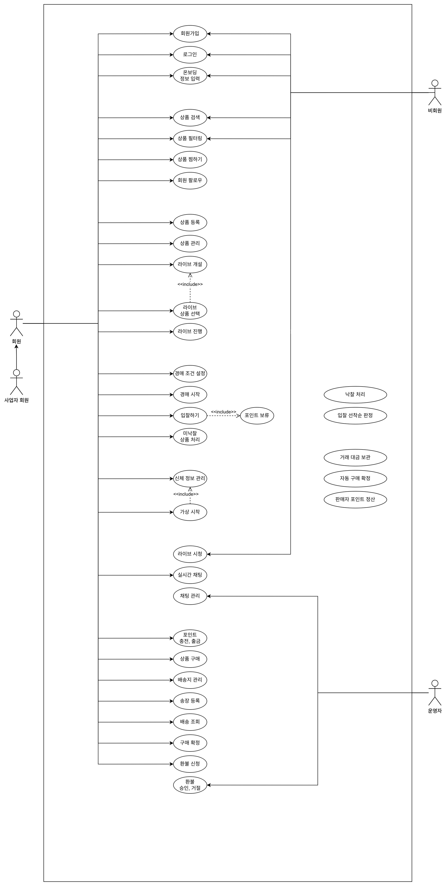

# 유스케이스 다이어그램, 명세서

## 🎯 문서 개요 (Overview)

---

## 세부 사항 (Details)

---

### 👤 액터 정의

- **비회원:** 조회 및 시청 등 제한적인 기능만 사용 가능.
- **회원:** 플랫폼의 핵심 사용자.
- **사업자 회원:** 회원을 상속 받아 회원의 권한을 모두 포함. 세금계산서 작성 등 사업자를 위한 기능 제공.
- **운영자:** 채팅 및 환불 관리 기능을 수행.

---

### 📋 유스케이스 목록 및 명세

**1. 계정 및 온보딩**

| 유스케이스명 | 연결 액터 | 설명 |
| --- | --- | --- |
| **회원가입** | 비회원, 회원 | 사용자가 서비스에 가입하는 기능 |
| **로그인** | 비회원, 회원 | 서비스 접속을 위해 인증하는 기능 |
| **온보딩 정보 입력** | 비회원, 회원 | 가입 및 로그인 후 필요한 초기 정보를 입력하는 기능 |

**2. 탐색**

| 유스케이스명 | 연결 액터 | 설명 |
| --- | --- | --- |
| **상품 검색** | 비회원, 회원 | 상품을 검색하는 기능 |
| **상품 필터링** | 비회원, 회원 | 검색된 상품에 필터를 적용하는 기능 |
| **상품 찜하기** | 회원 | 특정 상품을 관심 목록에 등록하는 기능 |
| **회원 팔로우** | 회원 | 다른 회원을 팔로우하는 기능 |

**3. 상품 및 라이브**

| 유스케이스명 | 연결 액터 | 설명 |
| --- | --- | --- |
| **상품 등록** | 회원 | 새로운 상품을 시스템에 등록하는 기능 |
| **상품 관리** | 회원 | 등록된 상품의 정보를 관리하는 기능 |
| **라이브 개설** | 회원 | 라이브 방송을 개설하는 기능 |
| **라이브 상품 선택** | 회원 | 라이브에서 판매할 상품을 선택하는 기능 |
| **라이브 진행** | 회원 | 개설된 라이브 방송을 송출/진행하는 기능 |

**4. 경매**

| 유스케이스명 | 연결 액터 | 설명 |
| --- | --- | --- |
| **경매 조건 설정** | 회원 | 경매를 위한 제반 조건을 설정하는 기능 |
| **경매 시작** | 회원 | 설정된 조건으로 경매를 시작하는 기능 |
| **입찰하기** | 회원 | 진행 중인 경매에 입찰하는 기능 |
| **포인트 보류** | 없음 (포함) | 입찰하기 수행 시 `<<include>>` 관계로 반드시 수행되는 기능 |
| **미낙찰 상품 처리** | 회원 | 유찰된 상품에 대한 후속 처리를 진행하는 기능 |

**5. 가상 시착**

| 유스케이스명 | 연결 액터 | 설명 |
| --- | --- | --- |
| **신체 정보 관리** | 회원 | 가상 시착을 위한 신체 정보를 관리하는 기능 |
| **가상 시착** | 회원 | `<<include>>` 관계로 신체 정보 관리를 필수로 포함하여 시착하는 기능 |

**6. 라이브 시청 및 소통**

| 유스케이스명 | 연결 액터 | 설명 |
| --- | --- | --- |
| **라이브 시청** | 비회원, 회원 | 라이브 방송을 시청하는 기능 |
| **실시간 채팅** | 회원 | 라이브 시청 중 실시간 채팅을 입력하는 기능 |
| **채팅 관리** | 운영자 | 운영자가 실시간 채팅을 관리/통제하는 기능 |

**7. 주문 및 결제, 클레임**

| 유스케이스명 | 연결 액터 | 설명 |
| --- | --- | --- |
| **포인트 충전/출금** | 회원 | 결제를 위한 포인트를 관리하는 기능 |
| **상품 구매** | 회원 | 상품에 대한 구매를 진행하는 기능 |
| **배송지 관리** | 회원 | 배송 받을 주소를 관리하는 기능 |
| **송장 등록** | 회원 | 배송을 위한 운송장 번호를 등록하는 기능 |
| **배송 조회** | 회원 | 배송 진행 상태를 조회하는 기능 |
| **구매 확정** | 회원 | 수령 후 구매를 최종 확정하는 기능 |
| **환불 신청** | 회원 | 구매한 상품에 대해 환불을 요청하는 기능 |
| **환불 승인/거절** | 운영자 | 요청된 환불 건에 대해 운영자가 처리하는 기능 |

**8. 기타 시스템/백그라운드 기능**

- **낙찰 처리**
- **입찰 선착순 판정**
- **거래 대금 보관**
- **자동 구매 확정**
- **판매자 포인트 정산**

---

### 🗺️ 유스케이스 다이어그램

